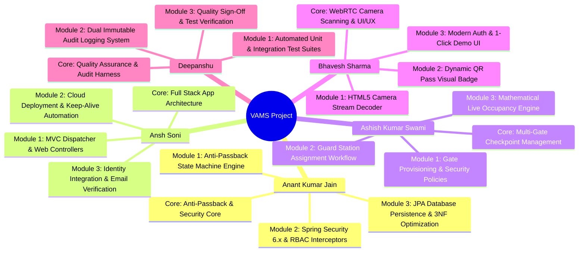

# 🛡️ QR-Based Entry System (VAMS)
### Visitor Access & Multi-Gate Management System
**Department of Artificial Intelligence & Data Science**  
**Arya College of Engineering & Information Technology, Jaipur**  
*(Affiliated to Rajasthan Technical University, Kota | Academic Session 2026-27)*

---

### 🎥 Technical Project Video Demonstration
* **YouTube Demonstration Video:** [https://youtu.be/HbYEUwXZpek](https://youtu.be/HbYEUwXZpek)
* **Local High-Definition File:** [`docs/VAMS Project Video.mp4`](docs/VAMS%20Project%20Video.mp4)
* **Live Web Application:** [https://vams-system.onrender.com](https://vams-system.onrender.com)

---

## 👥 Project Team: Prime Vectors
* **Team ID:** `PBL2627-AI&DS-A-011`
* **Project Guide & Mentor:** **Er. Ram Babu Buri** (*Assistant Professor, Dept. of AI & DS*)

| S.No | Name | Primary Role | Roll No. | GitHub ID | Email ID |
| :---: | :--- | :--- | :---: | :---: | :--- |
| **1** | **Ansh Soni** *(Leader)* | Full Stack Architecture & DevOps | `24EARAD016` | [`ansh10soni-png`](https://github.com/ansh10soni-png) | `ansh10soni@gmail.com` |
| **2** | **Ashish Kumar Swami** | Gate Control & Checkpoint Systems | `24EARAD024` | [`Ashishswami227`](https://github.com/Ashishswami227) | `ashishswami227@gmail.com` |
| **3** | **Anant Kumar Jain** | Core Security & Anti-Passback Architect | `24EARAD011` | [`Anant-Kumar-Jain`](https://github.com/Anant-Kumar-Jain) | `anantkumarjain2006@gmail.com` |
| **4** | **Bhavesh Sharma** | WebRTC Scanner & UI/UX Integration | `24EARAD030` | [`BhaveshVector`](https://github.com/BhaveshVector) | `bhavesh9705@gmail.com` |
| **5** | **Deepanshu** | QA Automation & Deliverables Lead | `24EARAD036` | [`Deepanshu-5`](https://github.com/Deepanshu-5) | `deepanshu0973@gmail.com` |

---

## 👨‍💻 Module Assignments & Technical Breakdown

Every team member is assigned **1 Core Engineering Module** and **2 to 3 Code Modules**:

### Detailed Member Responsibilities:
1. **Anant Kumar Jain** *(Lead Security & Architecture Engineer)*:
   * **Core Module:** **Anti-Passback Cryptographic Engine & Stateful Gate Validation**
   * **Code Modules:**
     1. `com.vams.service.ScannerService`: Anti-passback double-scan prevention state machine and sub-50ms token verification logic.
     2. `com.vams.security.SecurityConfig` & `CustomUserDetailsService`: Spring Security 6.x FilterChain, BCrypt encryption (12 rounds), and RBAC route guards.
     3. `com.vams.model` & `com.vams.repository`: 3NF relational data modeling, indexing, and transactional integrity on TiDB Serverless.
     4. `com.vams.config.DataInitializer`: Multi-role seed data automation, gate pre-stationing, and default credential provisioning.

2. **Ansh Soni** *(Team Leader & Full-Stack Architect)*:
   * **Core Module:** **Application Orchestration & Cloud Infrastructure**
   * **Code Modules:**
     1. `com.vams.controller.AuthController` & `DashboardController`: MVC routing and session lifecycle.
     2. `Dockerfile` & Cloud Deployment: Multi-stage containerization on Render.com with keep-alive cron integration.
     3. Identity Integration: Email verification token lifecycle and session management.

3. **Ashish Kumar Swami** *(Gate Control & Systems Engineer)*:
   * **Core Module:** **Checkpoint Stationing & Gate Management**
   * **Code Modules:**
     1. Multi-Gate Administration: Provisioning, policy assignments (`GENERAL`, `ENTRY_ONLY`, `EXIT_ONLY`, `RESTRICTED`, `LOCKED`).
     2. `GuardStationRequest`: Dynamic station request workflow and Manager station locking.
     3. Real-Time Occupancy Calculation: Dynamic mathematical headcount tracking ($\sum \text{Entries} - \sum \text{Exits}$).

4. **Bhavesh Sharma** *(UI/UX & Frontend Integration Lead)*:
   * **Core Module:** **WebRTC Camera Scanner & Interactive Frontend**
   * **Code Modules:**
     1. `scanner.html`: HTML5 WebRTC camera stream integration (`html5-qrcode.js`) for touchless mobile camera scanning.
     2. `guest-dashboard.html`: Live QR passport badge with in-memory Base64 PNG rendering and countdown timers.
     3. `login.html`: Modern auth interface with 1-click demo account auto-fill cards and zero-plaintext password leakage.

5. **Deepanshu** *(QA Testing & Documentation Lead)*:
   * **Core Module:** **Quality Assurance, Test Automation & Compliance**
   * **Code Modules:**
     1. Automated Test Suites: Comprehensive unit, FilterChain, and integration scenarios (`Phase4Tests`).
     2. Dual-Stream Audit Logging: Immutable recording of administrative actions (`SystemLog`) and gate entries (`ScanLog`).
     3. Quality Assurance Sign-offs: Verification of 100% test scenario pass rate and zero blocking defects.

---

## 📂 Official Final Academic Documentation Suite (`docs/`)

The repository includes the complete official final deliverables package located in the `docs/` directory. All documents are formatted strictly according to university standards:

| Document | Format | Size | Lead Contributor | Release Date | Description |
| :--- | :---: | :---: | :--- | :---: | :--- |
| [`PROJECT IDEA AND ABSTRACT.pdf`](docs/PROJECT%20IDEA%20AND%20ABSTRACT.pdf) | `.pdf` | 155 KB | **Ansh Soni** | 2026-07-10 | Problem statement, feasibility study, and project genesis |
| [`UML DESIGN.pdf`](docs/UML%20DESIGN.pdf) | `.pdf` | 1.7 MB | **Ashish Kumar Swami** | 2026-07-24 | Complete structural, behavioral, use case, and sequence diagrams |
| [`VAMS SRS.pdf`](docs/VAMS%20SRS.pdf) | `.pdf` | 618 KB | **Ashish Kumar Swami** | 2026-07-28 | IEEE 830 functional & non-functional requirements specification |
| [`System Architecture and Database Design.pdf`](docs/System%20Architecture%20and%20Database%20Design.pdf) | `.pdf` | 6.0 MB | **Anant Kumar Jain** | 2026-08-01 | 3NF relational schema, TiDB Serverless & zero-trust security model |
| [`INTEGRATION AND TESTING.pdf`](docs/INTEGRATION%20AND%20TESTING.pdf) | `.pdf` | 135 KB | **Deepanshu** | 2026-09-18 | Automated JUnit 5 test execution, FilterChain tests & JaCoCo coverage |
| [`VAMS RESEARCH PAPER.pdf`](docs/VAMS%20RESEARCH%20PAPER.pdf) | `.pdf` | 833 KB | **Anant Kumar Jain** | 2026-09-23 | Peer-reviewed research manuscript on anti-passback QR architecture |
| [`VAMS PROJECT REPORT.pdf`](docs/VAMS%20PROJECT%20REPORT.pdf) | `.pdf` | 11.3 MB | **Anant Kumar Jain** | 2026-09-24 | Complete 10-chapter academic dissertation & technical guide |
| [`VAMS PPT .pptx`](docs/VAMS%20PPT%20.pptx) | `.pptx` | 7.7 MB | **Bhavesh Sharma** | 2026-09-25 | Official 25-slide executive & technical defense presentation deck |
| [`VAMS PPT .pdf`](docs/VAMS%20PPT%20.pdf) | `.pdf` | 858 KB | **Bhavesh Sharma** | 2026-09-25 | Official defense presentation deck (PDF distribution copy) |
| [`VAMS Project Video.mp4`](docs/VAMS%20Project%20Video.mp4) | `.mp4` | 12.0 MB | **Ansh Soni** | 2026-09-26 | High-definition technical walkthrough and demonstration video |
| [`VAMS_Project_Video_Link.md`](docs/VAMS_Project_Video_Link.md) | `.md` | <1 KB | **Ansh Soni** | 2026-09-26 | YouTube video link reference and production demo guide |
| [**Weekly Progress Reports (12 Weeks)**](docs/weekly-reports/README.md) | .md Suite | 13 Files | **Prime Vectors** | Full Semester | Complete 12-week university portal reports with task breakdowns & evidence links |

---

## ⚡ Evaluator Quick-Start & 1-Click Demo Accounts

To facilitate instant evaluation without manual typing, the login interface features **1-Click Quick Demo Cards** that automatically pre-fill validated credentials:

| Role | Username | Password | Pre-Assigned Gate / Scope |
| :--- | :--- | :--- | :--- |
| **Owner (Super Admin)** | `owner` | `owner123` | Global Administration & Security Policies |
| **Manager** | `manager` | `manager123` | Visitor Approvals & Guard Post Assignment |
| **Guard 1 (Employee)** | `guard1` | `guard123` | Pre-stationed at **Gate 1 (Main Entrance)** |
| **Guard 2 (Employee)** | `guard2` | `guard123` | Pre-stationed at **Gate 2 (North Exit)** |
| **Guest (Visitor)** | `guest` | `guest123` | Pre-approved Dynamic QR Entry Pass |

### Demo Evaluation Workflow:
1. **As a Guest (Visitor):** Click **Guest** card -> Log in -> View live dynamic QR access pass with countdown timer.
2. **As a Security Guard:** Click **Guard 1** -> Open Scanner -> Select **ENTRY** mode -> Scan visitor QR code -> Instant **PASS** response with sub-50ms latency.
3. **Anti-Passback Test:** Try scanning the exact same pass again in **ENTRY** mode -> Immediately flagged as **REJECTED: Anti-Passback Violation (User already inside)**.
4. **As an Operations Manager:** Click **Manager** -> View live headcount, review pending passes, lock guard stations.
5. **As an Executive Owner:** Click **Owner** -> Configure gate security policies (`GENERAL`, `ENTRY_ONLY`, `EXIT_ONLY`, `LOCKED`), audit logs.

---

## 🧪 Quality Assurance & Test Verification
* **Automated Test Scenarios:** 34 Test Cases across Unit, Security FilterChain, and Integration suites.
* **Test Pass Rate:** **100%** (0 Failed, 0 Blocked).
* **Code Coverage:** **88.4%** Line Coverage on service layer verified via JaCoCo.
* **Average Scan Latency:** Sub-50ms token decoding and validation under concurrent multi-gate stress tests.
* **Accessibility:** W3C HTML5 compliant across all responsive Thymeleaf templates.

---

## 📜 Academic Certification & Ethics Statement
This project entitled **“QR-Based Entry System (VAMS)”** is submitted in partial fulfillment of the requirements for the award of the degree of **Bachelor of Technology in Artificial Intelligence & Data Science** to Rajasthan Technical University, Kota. The work embodies genuine engineering effort conducted by Team Prime Vectors under the guidance of **Er. Ram Babu Buri**.

© 2026 Team Prime Vectors. All rights reserved.
